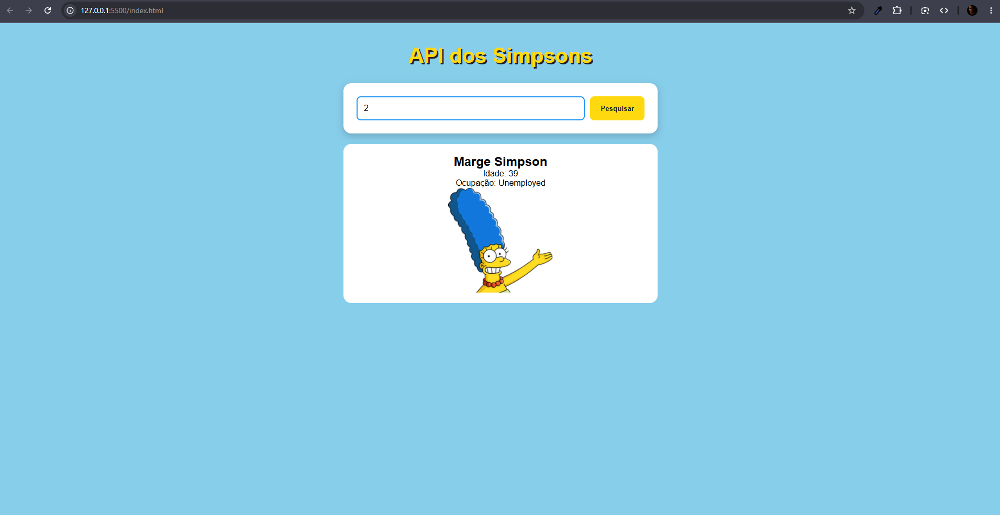
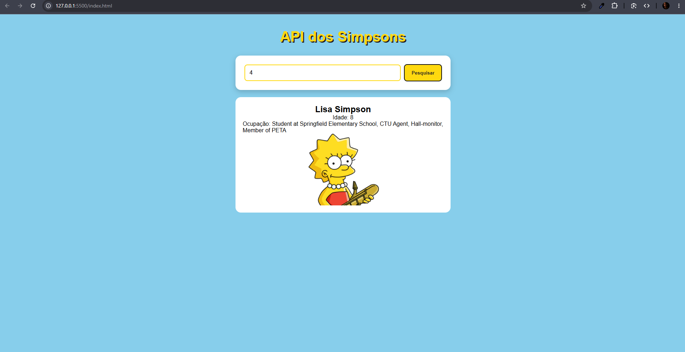

# API utilizada

Para o desenvolvimento do projeto, decidimos utilizar a API **The Simpsons API**, disponível em: https://thesimpsonsapi.com.

# O que foi desenvolvido

Ao realizar uma requisição à API, os dados dos personagens são retornados no formato JSON. Entre as informações disponibilizadas estão:

- ID do personagem;
- Idade;
- Data de aniversário;
- Gênero;
- Nome;
- Ocupação;
- Imagem do personagem;
- Frase característica;
- Status.

# Endereço da requisição

Um exemplo de endereço utilizado para acessar os dados dos personagens é:

https://thesimpsonsapi.com/api/characters

# Como executar o sistema

Na barra de pesquisa do sistema, basta digitar um número correspondente ao ID de um personagem. Após realizar a pesquisa, as informações do personagem escolhido serão exibidas na tela.

# Capturas do sistema em funcionamento

**Personagem: Marge**

**Personagem: Lisa**

# Dificuldades encontradas

A principal dificuldade encontrada durante o desenvolvimento foi a ausência de um filtro de pesquisa nativo por parâmetros na URL da API. Por esse motivo, foi necessário adaptar a lógica de busca no próprio sistema para localizar os personagens de acordo com o ID informado pelo usuário.
